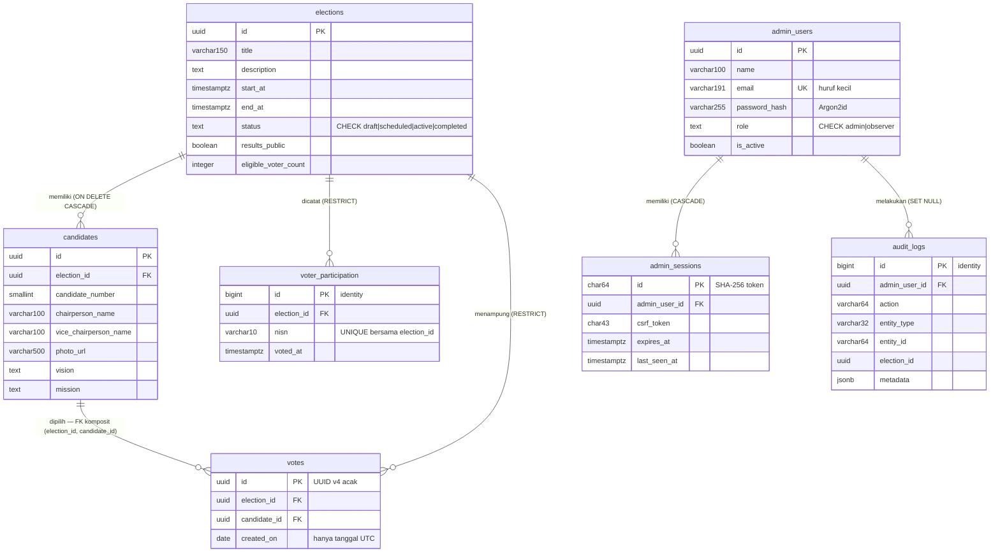

# Skema Database E-OSIS (PostgreSQL / Supabase)

Sumber kebenaran skema: [`server/migrations/`](../server/migrations). Target **PostgreSQL 14+**
(Supabase memakai PostgreSQL 15/17; suite tes dijalankan di PostgreSQL 17).

- Semua objek berada di **skema aplikasi** `DB_SCHEMA` (bawaan `eosis`, tes: `eosis_test`) —
  **bukan** `public`. Di Supabase, skema `public` otomatis dibuka lewat Data API (PostgREST) untuk
  role `anon`/`authenticated`; skema `eosis` tidak, dan `db:grants` mencabut akses role tersebut.
- Koneksi aplikasi & CLI menyetel `search_path` ke skema itu, sehingga SQL di kode dan migrasi
  memakai nama tabel tanpa prefiks skema. Di luar aplikasi (mis. SQL Editor Supabase), tulis
  lengkap: `eosis.elections`.
- Semua waktu bertipe `timestamptz` (titik waktu absolut). Hasilnya tidak bergantung pada zona
  waktu sesi maupun server database.

## Diagram relasi



**Tidak ada** relasi antara `votes` dan `voter_participation`, dan `votes` tidak memiliki kolom NISN.

## Tabel

### `elections`

| Kolom | Tipe | Keterangan |
|---|---|---|
| `id` | `uuid` | PK |
| `title` | `varchar(150)` | Judul pemilihan |
| `description` | `text NULL` | Ditampilkan publik |
| `start_at`, `end_at` | `timestamptz` | Jendela pemungutan suara; `CHECK (end_at > start_at)` |
| `status` | `text` + `CHECK (status IN ('draft','scheduled','active','completed'))` | Diubah panitia |
| `results_public` | `boolean DEFAULT FALSE` | Izin publikasi hasil (berlaku bila `completed`) |
| `eligible_voter_count` | `integer NULL`, `CHECK (> 0)` | Penyebut resmi partisipasi dari sekolah; `NULL` = tidak diketahui |
| `created_at`, `updated_at` | `timestamptz` | `updated_at` diisi trigger `set_updated_at()` setiap `UPDATE` |

Indeks: `uq_elections_single_active` — **indeks unik parsial** `ON elections (status) WHERE status = 'active'`
(database menjamin maksimal satu pemilihan aktif), `idx_elections_status_start (status, start_at)`,
`idx_elections_schedule (start_at, end_at)`.

### `candidates`

| Kolom | Keterangan |
|---|---|
| `election_id` | FK → `elections.id` `ON DELETE CASCADE` |
| `candidate_number` | `smallint`, `CHECK BETWEEN 1 AND 99`, `UNIQUE(election_id, candidate_number)` |
| `chairperson_name`, `vice_chairperson_name` | Nama Ketua & Wakil Ketua |
| `photo_url` | URL HTTPS atau `/uploads/candidates/<uuid>.(jpg|png|webp)` |
| `vision`, `mission` | `mission` berisi satu misi per baris |

`UNIQUE(election_id, id)` menjadi target foreign key komposit dari `votes`.

### `voter_participation` — *siapa* yang sudah memilih

| Kolom | Keterangan |
|---|---|
| `id` | `bigint GENERATED ALWAYS AS IDENTITY` (PK) |
| `election_id` | FK → `elections.id` `ON DELETE RESTRICT` |
| `nisn` | `varchar(10) COLLATE "C"` — **teks**, agar nol di depan tidak hilang; `CHECK (nisn ~ '^[0-9]{10}$')` |
| `voted_at`, `created_at` | `timestamptz DEFAULT now()` |

`UNIQUE(election_id, nisn)` = **penjaga utama anti voting ganda**. Indeks
`idx_participation_election_time (election_id, voted_at)` untuk hitung pemilih & grafik waktu.

### `votes` — *apa* yang dipilih

| Kolom | Keterangan |
|---|---|
| `id` | UUID **v4 acak** dari aplikasi (bukan identity/UUID berbasis waktu) agar urutan baris tidak bisa dicocokkan dengan `voter_participation` |
| `election_id` | FK → `elections.id` `ON DELETE RESTRICT` |
| `candidate_id` | FK komposit `(election_id, candidate_id) → candidates(election_id, id)` `ON DELETE RESTRICT` — kandidat **wajib** dari pemilihan yang sama |
| `created_on` | `date DEFAULT ((now() AT TIME ZONE 'UTC')::date)` — sengaja **hanya tanggal**; tipe `date` tidak dapat menyimpan jam |

Indeks `idx_votes_election_candidate (election_id, candidate_id)` melayani kedua FK sekaligus
menjadi indeks agregasi per kandidat.

### `admin_users`

`email` unik dan wajib huruf kecil (`CHECK (email = lower(email))`, sehingga keunikan tidak
membedakan kapital), `password_hash` hash Argon2id (`CHECK` hanya menerima awalan `$argon2id$`
atau `$2b$` — plaintext ditolak database), `role` (`CHECK admin|observer`), `is_active`,
`last_login_at`.

### `admin_sessions`

`id` = SHA-256 (hex) dari token cookie (token aslinya tidak disimpan; `CHECK` format hex 64),
`csrf_token`, `expires_at` (batas absolut), `last_seen_at` (batas idle), `user_agent`. FK ke
`admin_users` `ON DELETE CASCADE`.

### `audit_logs`

Append-only bagi akun aplikasi. `admin_user_id` nullable (`ON DELETE SET NULL`), `action`,
`entity_type`, `entity_id`, `election_id` (tanpa FK agar jejak tetap ada walau pemilihan draft
dihapus), `metadata jsonb` yang disanitasi. Indeks: `created_at`, `(election_id, created_at)`,
`(admin_user_id, created_at)`.

### `schema_migrations`

Dibuat oleh `npm run db:migrate`: `version`, `checksum` (SHA-256 isi file), `applied_at`. Akun
aplikasi tidak punya akses ke tabel ini.

## View pelaporan (`002_reporting_views.sql`)

| View | Isi | Dipakai untuk |
|---|---|---|
| `v_candidate_vote_counts` | `election_id, candidate_id, COUNT(*) AS vote_count` dari `votes` | Perolehan per kandidat & total suara sah |
| `v_participation_timeline` | `election_id, voted_at` dari `voter_participation` (**tanpa NISN**) | Jumlah pemilih unik & grafik partisipasi |

View PostgreSQL (tanpa opsi `security_invoker`) membaca tabel dasar dengan hak **pemilik view**
(akun migrasi), setara `SQL SECURITY DEFINER`: akun aplikasi cukup diberi `SELECT` pada view, tanpa
akses ke baris suara maupun kolom NISN.

Query agregasi yang dipakai (semuanya dalam satu transaksi `REPEATABLE READ READ ONLY` sehingga
seluruh angka berasal dari snapshot yang sama):

```sql
-- perolehan per kandidat (kandidat tanpa suara tetap muncul)
SELECT c.id, c.candidate_number, COALESCE(v.vote_count, 0) AS vote_count
  FROM candidates c
  LEFT JOIN v_candidate_vote_counts v ON v.election_id = c.election_id AND v.candidate_id = c.id
 WHERE c.election_id = $1 ORDER BY c.candidate_number;

-- total suara sah
SELECT COALESCE(SUM(vote_count), 0) FROM v_candidate_vote_counts WHERE election_id = $1;

-- pemilih unik
SELECT COUNT(*) FROM v_participation_timeline WHERE election_id = $1;

-- partisipasi per interval waktu (date_bin, PostgreSQL 14+)
SELECT date_bin(make_interval(secs => $1), voted_at, TIMESTAMPTZ '1970-01-01 00:00:00+00') AS bucket_start, COUNT(*)
  FROM v_participation_timeline WHERE election_id = $2 GROUP BY bucket_start ORDER BY bucket_start;
```

## Hak akses akun aplikasi (`npm run db:grants`)

| Objek | Hak |
|---|---|
| skema `eosis` | `USAGE` |
| `elections`, `candidates`, `admin_sessions` | `SELECT, INSERT, UPDATE, DELETE` |
| `voter_participation`, `votes` | **`INSERT` saja** |
| `v_candidate_vote_counts`, `v_participation_timeline` | `SELECT` |
| `admin_users` | `SELECT`, `UPDATE (last_login_at)` |
| `audit_logs` | `SELECT, INSERT` |

- `db:grants` bersifat **tepat**, bukan aditif: dalam satu transaksi seluruh hak tabel akun
  aplikasi dicabut lalu diberikan ulang sesuai daftar di atas, sehingga hak lama yang terlalu luas
  ikut hilang. Keluarannya menampilkan hak yang berlaku sekarang.
- Sekaligus mencabut **semua** akses `PUBLIC` dan role Data API Supabase (`anon`, `authenticated`,
  `service_role`) dari skema, tabel, sequence, dan fungsi di skema aplikasi — termasuk hak yang
  mungkin diberikan lewat *default privileges*.
- **RLS (Row Level Security)**: tiap tabel diberi policy `app_role_access` (`FOR ALL TO eosis_app
  USING (true) WITH CHECK (true)`). RLS sendiri tidak wajib — skema tidak terekspos Data API dan
  batas akses diatur GRANT — tetapi bila RLS dinyalakan (mis. lewat dashboard Supabase), RLS tanpa
  policy akan menolak semua baris bagi akun aplikasi. Policy ini tidak melonggarkan GRANT: akun
  aplikasi tetap hanya bisa `INSERT` ke `votes`/`voter_participation` (diuji `tests/rls.test.js`).
- Akun aplikasi dibuat oleh `db:create`/`db:setup` sebagai role `LOGIN NOSUPERUSER NOCREATEDB
  NOCREATEROLE`. Password-nya dikirim ke server sebagai **verifier SCRAM-SHA-256** yang dihitung di
  sisi klien, sehingga tidak pernah tercatat sebagai teks biasa di log PostgreSQL/Supabase.
- Akun migrasi (DDL/GRANT, mis. `postgres` di Supabase) hanya dipakai skrip CLI, tidak pernah oleh
  server yang berjalan. Ia menjadi pemilik semua objek di skema aplikasi.

## Migrasi

- File `NNN_nama.sql` dijalankan berurutan oleh `npm run db:migrate` di skema aplikasi (dibuat bila
  belum ada), dicatat di `schema_migrations (version, checksum, applied_at)`.
- DDL PostgreSQL bersifat **transaksional**: setiap file dijalankan dalam satu transaksi bersama
  pencatatannya. Migrasi yang gagal dibatalkan seluruhnya — tidak ada tabel setengah jadi.
- Mengubah file migrasi yang sudah diterapkan akan **ditolak** (checksum berbeda) — buat file baru.
- Setelah migrasi yang menambah tabel/view, jalankan ulang `npm run db:grants`.
- Checksum dihitung dari isi file dengan line ending dinormalisasi (LF), sehingga tetap sama walau
  Git di Windows mengubah file menjadi CRLF.
- **SQL Editor Supabase**: `server/sql/setup.sql` berisi role aplikasi + seluruh migrasi + pencatatan
  `schema_migrations` + grant dalam satu script, dibuat otomatis oleh `npm run db:sql` (tes unit
  memastikan file itu selalu sesuai migrasi). Hasilnya identik dengan `db:setup`; lihat README 6.2.
- `npm run db:reset -- --yes` menjalankan `DROP SCHEMA <DB_SCHEMA> CASCADE` lalu membangun ulang.
  Hanya skema aplikasi yang terhapus; skema bawaan Supabase (`auth`, `storage`, `public`, …) tidak
  tersentuh dan tidak bisa dipilih sebagai `DB_SCHEMA`.
